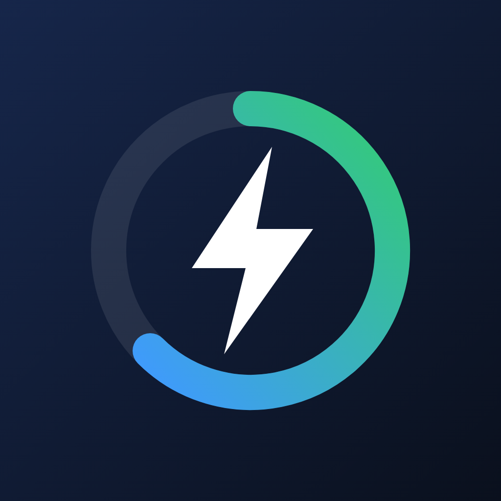
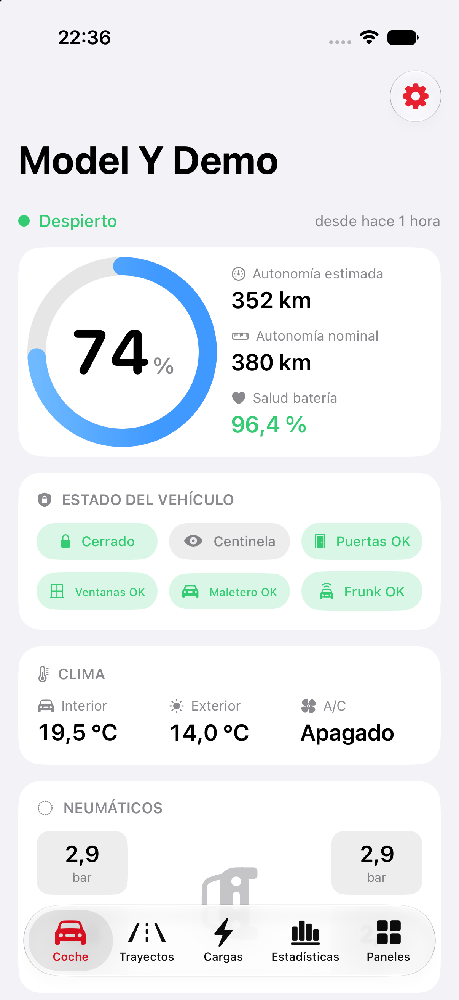
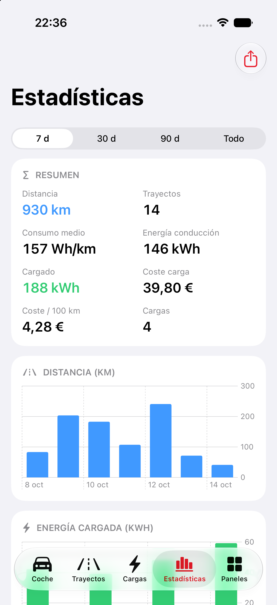
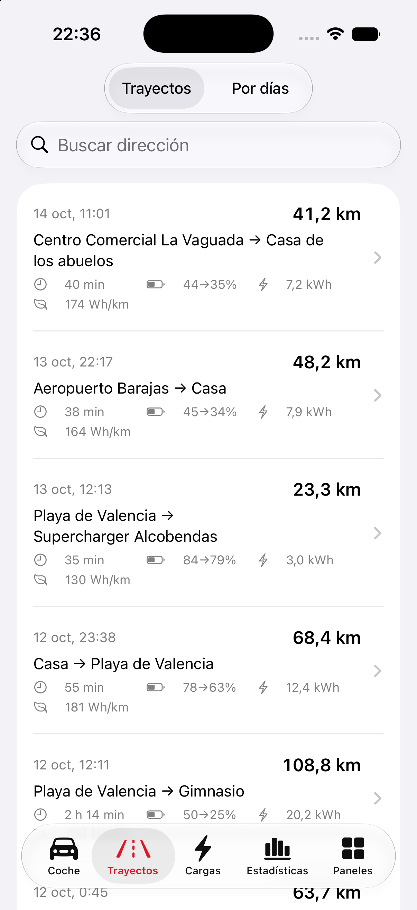

# WattBoard

**EN** · Native iPhone, Mac & Android viewer for the car data on your own server. No cloud, no account, no tracking.
**ES** · Visor nativo para iPhone, Mac y Android de los datos de coche de tu propio servidor. Sin nube, sin cuenta, sin rastreo.

> **Status / Estado:** testing / en pruebas. Not yet in the App Store or Google Play.

## What it does
- Car status, battery, range, climate, tyres, doors and locks (via your server's REST API).
- Drives and charges with filters, stats by date range, CSV and GPX export.
- Widgets, Apple Watch, charge and plug-in alerts, offline cache.
- Your own Grafana dashboards as native screens.
- Face ID / fingerprint lock, privacy mode, QR setup between devices.
- 7 languages: es, en, de, fr, pt, zh, fi.

## Downloads / Descargas
iOS / iPadOS / macOS: TestFlight (by invitation) · por invitación. Android: Google Play (closed test) · prueba cerrada en Google Play. The macOS test build in [Releases](../../releases) can be verified with [VERIFY.md](VERIFY.md) · El zip de macOS de [Releases](../../releases) se puede comprobar con [VERIFY.md](VERIFY.md).

## Privacy
Your data goes straight from **your server** to **your phone**. There is no WattBoard server, no account and no analytics. See the [privacy policy](PRIVACY.md) · [política de privacidad](PRIVACIDAD.md).

## Testing / Pruebas
Want to try it? iPhone, iPad and Mac: open an [issue](../../issues/new/choose) or write to **wattboardapp@gmail.com** and you will get a TestFlight invitation. Android: the test version is distributed through Google Play (closed test); write to the same address with your Gmail to be added. The old APK in [Releases](../../releases) is obsolete and no longer updated.
¿Quieres probarla? iPhone, iPad y Mac: escribe a **wattboardapp@gmail.com** o abre un [issue](../../issues/new/choose) y recibirás una invitación de TestFlight. Android: la versión de pruebas va por Google Play (prueba cerrada); escribe al mismo correo con tu Gmail para que te añada. El APK antiguo de [Releases](../../releases) está obsoleto y ya no se actualiza.

## Free / Gratis
WattBoard is free, with no paid plans: car, drives, charges, statistics, Grafana dashboards, widgets and share cards, all included · WattBoard es gratuita, sin planes de pago: coche, trayectos, cargas, estadísticas, dashboards de Grafana, widgets y tarjetas, todo incluido.

## What you need
A self-hosted server of your own that logs your car's data, with its REST API and/or Grafana. Never expose these services to the internet without protection: use HTTPS or a private connection.

## Disclaimer
WattBoard is an independent project and is not affiliated with, endorsed by, or sponsored by Tesla, Inc. Tesla is a trademark of Tesla, Inc.

© zerocoolspain. All rights reserved. This repository contains project information only, not the source code.
